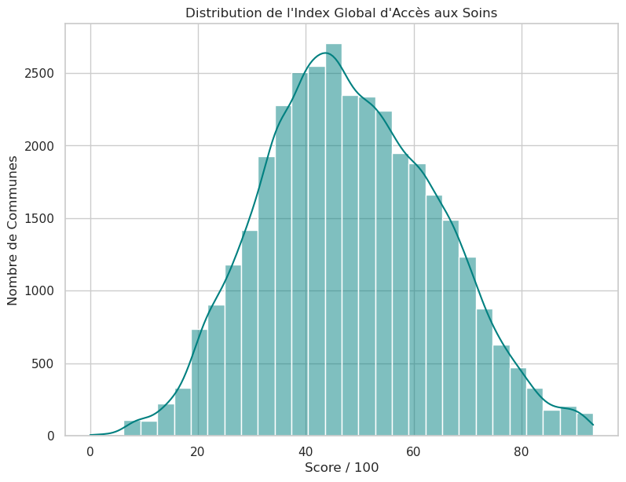
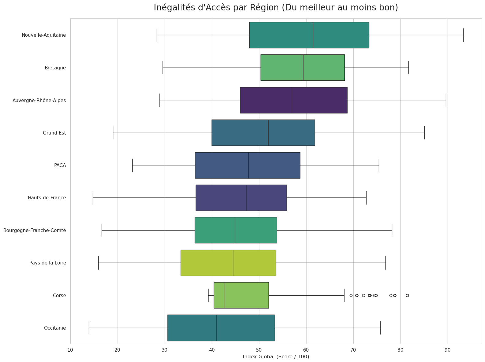
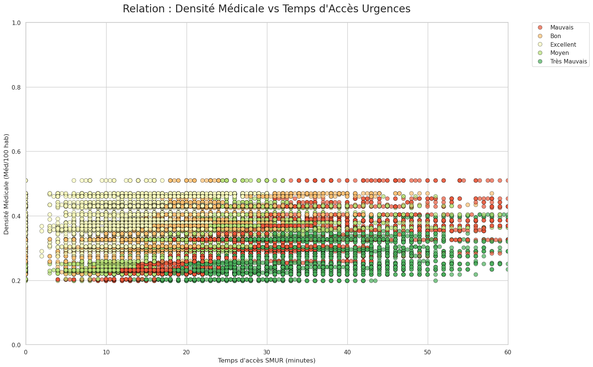
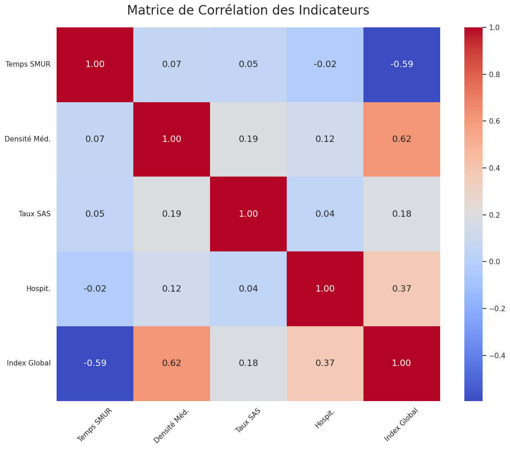

# Analyse de l'accès aux soins en France

Évaluation de la couverture médicale en France à partir de données géographiques, démographiques et hospitalières, avec la construction d'un **indice global d'accès aux soins (0 à 100)** pour 35 000 communes.

🗺️ **Cartes interactives** : [temps d'accès aux urgences](https://asaintpaul.github.io/healthcare-access-analysis-france/carte_chaleur_acces.html) · [localisation des hôpitaux](https://asaintpaul.github.io/healthcare-access-analysis-france/carte_hopitaux.html)

## Résultats clés

- **Score moyen d'accès aux soins : 48,3 / 100.** Le temps d'accès moyen à un SMUR est de 23 minutes, mais il atteint jusqu'à 163 minutes dans les territoires les plus isolés.
- **Une fracture régionale nette** : la Nouvelle-Aquitaine (61,2) et la Bretagne (59,0) arrivent en tête, l'Occitanie (42,5) ferme la marche. La région PACA a la plus forte densité médicale mais des temps d'accès aux urgences parmi les plus longs.
- **Médecins et urgences sont deux dimensions indépendantes** (corrélation de 0,07) : au-delà de 30 minutes d'un SMUR, le score s'effondre, même dans les communes bien dotées en médecins.

## Visualisations

## Méthodologie

Chaîne de traitement : **Fetch → Clean → Structure → Model → Analyze → Visualize**

1. **Collecte** : 5 jeux de données ouvertes récupérés via des API (Ameli, DREES, OpenStreetMap) : couverture SAS, localisation des hôpitaux, accès aux soins urgents, hospitalisations, densité des médecins généralistes.
2. **Nettoyage et structuration** : harmonisation des codes communes INSEE, conversion des coordonnées géographiques, fusion des sources.
3. **Modélisation** : normalisation de quatre indicateurs entre 0 et 100, puis indice global pondéré et classement en 5 classes d'accès.
4. **Analyse** : statistiques descriptives, classements régionaux et départementaux, matrice de corrélation de Pearson.
5. **Visualisation** : graphiques (matplotlib, seaborn) et cartes interactives (Folium).

## Outils

Python (`pandas`, `numpy`, `matplotlib`, `seaborn`, `folium`) · Données ouvertes de santé (Ameli, DREES, OpenStreetMap, geo.api.gouv.fr)

## Fichiers

| Fichier | Contenu |
|---|---|
| `healthcare-access-analysis-france.ipynb` | Notebook complet (code, graphiques et interprétations) |
| `carte_chaleur_acces.html` | Carte interactive du temps d'accès aux urgences |
| `carte_hopitaux.html` | Carte interactive des hôpitaux |
| `images/` | Graphiques de l'analyse |

## Auteures

Andréa Saint Paul et Guillemette Cipriano – Université de Bordeaux
